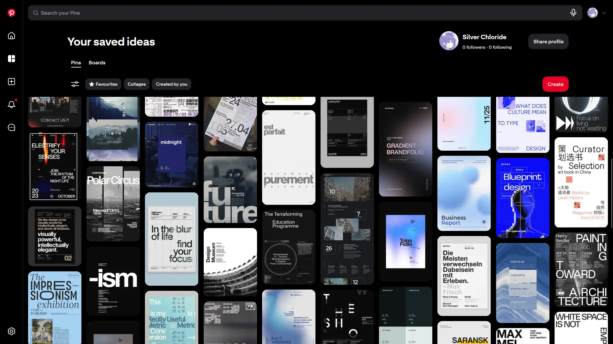

## Intro

For me it has always been a conundrum designing and crafting the ideal portfolio in my mind: lack of experience, missing skills, and a shortage of time. In the past 3 years or so, I've been constantly exploring what I actually want. After hundreds of nights viewing sketches from Pinterest and Dribbble[^1], and thanks to the wonderful open-source world, the project somehow grew.



[^1]: Websites where designers look for their style inspirations.

Having been on the fence for a long time, I created a new Figma file, drew some random prototypes, and finally crafted an immature product; then the cycle began. As my taste shifts, it's pretty ironic that I kept looping, just to chase my _perfectionistic overthinker_ personality. As such, I may be creating a new post describing the same truth in the future, but let's just stick to the yet-another shelter temporarily: I want to share a lot, about the technical choice, the attitude toward AI, and the mindset toward details throughout the entire process.

## The Evolutionary Path

In case you're interested, head to [web.archive.org](https://web.archive.org) and find the snapshots.

I started the very early project using Bootstrap 4 :dim[(can't believe it's v6 now)], then Material Design 3 with a library I can't really recall now, then shadcn/ui as the wave of Tailwind CSS arrived, at last just a primitive UI library with all styles handwritten.

Obviously people are keen on UI frameworks that just works: beautiful and easy-to-use. There are several problems lying in these tools:

### Too Common

What should a personal website be? First, it has to be _personal_. That's probably the reason why I never decided on a universal template option like Hugo, Jekyll or VitePress :dim[(they're excellent though!)], with a so-called awesome theme which a random blogger recommends to everyone.

Definitely, I don't want my website, as my appearance on the web, to be 80% similar to others. One can certainly depends on existing designs, uses UI libraries to make products. But no, not a portfolio.

### Too Complicated

Tailwind CSS is well-known to everyone when people complain about the awful combination of HTML and CSS. If you want to make something centred, just type `flex items-center`, and you're easily obsessed with this; then more Tailwind is produced:

```tsx "...(458 characters)" caption="shadcn/ui Button (partial)"
const buttonVariants = cva(
  "group/button inline-flex shrink-0 items-center justify-center ...(458 characters) [&_svg]:pointer-events-none [&_svg]:shrink-0 [&_svg:not([class*='size-'])]:size-4",
  {
    variants: {
      variant: {
        default: "bg-primary text-primary-foreground hover:bg-primary/80",
        outline:
          "border-border bg-background hover:bg-muted hover:text-foreground aria-expanded:bg-muted aria-expanded:text-foreground dark:border-input dark:bg-input/30 dark:hover:bg-input/50",
        // ...
      },
      // ...
    },
    defaultVariants: {
      variant: "default",
      size: "default",
    },
  }
)
```

Wait, is Tailwind supposed to be used for this?

Projects using these kinds of components often have their class strings messed up, which can result in a "className soup". Apparently, you can use `@apply` instead, but why not use vanilla CSS in that case?

I was once passionate about writing stylesheets this way. Yet, before bringing more knives to a gunfight, I saw people increasingly [abandoning Tailwind and embracing modern CSS](https://en.andros.dev/blog/af3ee191/why-i-dont-recommend-tailwind-css/). For those feeling indecisive about whether to switch, a personal website is a brilliant lab: it contains just a few components and is fully under a curious brain's control.

```css caption="The same Button in modern CSS"
.button {
  display: inline-flex;
  align-items: center;
  justify-content: center;
  flex-shrink: 0;
  svg {
    pointer-events: none;
    flex-shrink: 0;
  }
  /* ... */

  &.default {
    color: var(--gray-12);
    background-color: var(--gray-3);
    &:is(:hover, :focus-visible) {
      background-color: var(--gray-4);
    }
  }
  &.outline {
    /* ... */
  }
}
```

:::note[More on styling]
Giving up styling tools entirely is not wise either. Writing everything using CSS Modules (like page layouts) can be equally annoying, that's where an Atomic CSS framework really shines.

I'd like to leave a loose end for future articles on this.
:::

### Too Limited

As I've said, a personal website is _personal_. Whether you want to add fancy styles to every part, to test out the newest web features, or to write articles with interactive examples, you should not be confined by a dedicated framework. It just feels cool when everything exists under your command.

## AI Usage

I'm quite conservative in my use of LLMs: boosting my study, providing design inspirations :dim[(only as a reference because LLMs these days all have bad UI tastes, though with extra skills some models stand out sometimes)], resolving errors in an unfamiliar codebase, and that's all. I never introduced, and will unlikely introduce, AI into my coding workflow.

Currently coding agents are extremely robust and fabulously growing, along with a few obstacles that concern me:

1. **Vague copyright**. Agents generate code that may be uncopyrightable[^2];
2. **Poor taste**. LLMs can't see and feel like humans; therefore, they may generate _AI sloppy_ UI/UXs, sometimes terrible DXs as well :dim[(such as highly coupled code or repeatedly reinventing the wheel)];
3. **Uneasiness**. One can't predict what LLMs will output. Even strict code reviews result in incomplete human control.

[^2]: [Who Owns the Code Claude Wrote?](https://www.oreilly.com/radar/who-owns-the-code-claude-wrote/) The code may sit in the public domain. It's not a well-discussed issue that everyone cares about; however, an independent developer should definitely not be dragged into a copyright dispute that has arisen as a result.

The project contains zero AI code. [See the source](https://github.com/silvecor/silvecor.dev).

Besides these, there is much more I want to say on this topic. A separate article will later describe my insights on LLMs.

## The Details

Every single chatbot I've chatted with would summarise me as "a curious, restless, meticulous, detail-obsessed design engineer", and yes, sometimes even I myself argue whether that's worth it: especially in the evening after I spent all weekend tailoring the navigation bar.

However, I see more people being blamed for how clueless and mindless they are than for being enthusiastic and inquisitive, 😅. People probably find productivity in this process. Say a writer creates a novel. They're likely to release fewer errata if every section is completed with longer thoughts, to ensure it aligns with what the writer has in their mind. That's a situation which the writer, editors and readers all expect.

The opinion given may have to be corrected, as _productivity_ mostly refers to an output/input ratio. It's just that people ignore the time wasted while handling trivial, minor matters.

I won't assert that thinking of these details is equivalent to thinking of nothing, or a vital prerequisite, because I never know exactly how these will affect others, and even myself.

## What's Next

As you can see, this is the first post on [silvecor](https://silvecor.dev)'s website, so hello world! The site is still heavily WIP. As stated before, I'm holding a bunch of design ideas and features waiting to join the canvas.

I'd like to thank the authors of [Carbon Design System](https://www.carbondesignsystem.com/), [astro-erudite](https://astro-erudite.vercel.app/), and [Fumadocs](https://www.fumadocs.dev/) for their awesome work, which inspired and motivated me to keep baking my design and code.

Also, more interesting articles are coming. Stay tuned!
